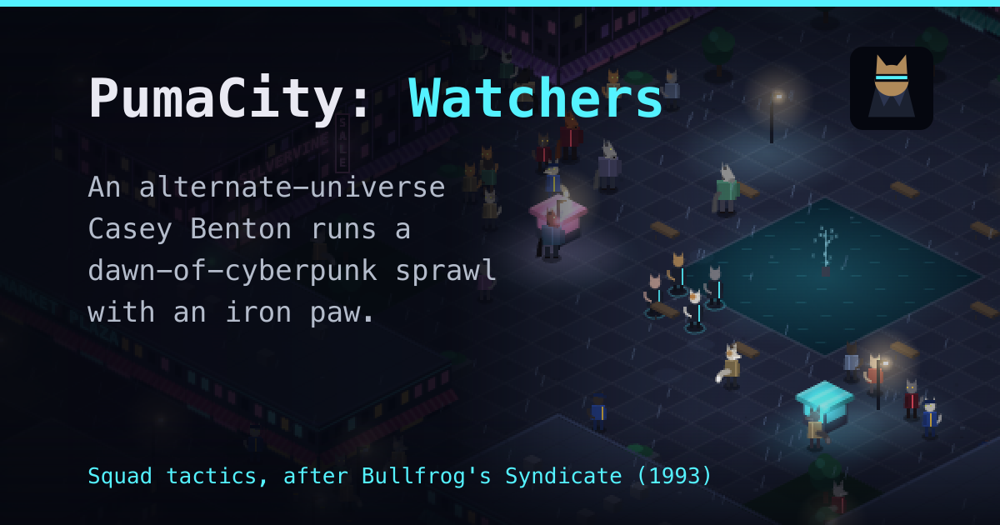

# PumaCity: Watchers



An alternate-universe Casey Benton runs a dawn-of-cyberpunk sprawl with an
iron paw. Manage the city while building an elite team of enforcers to push
out a new rival.

A squad tactics game heavily inspired by Bullfrog's *Syndicate* (1993).

**Play it online:** <https://greykit.com/games/watchers/>. Nothing to install.

## Play it on your own computer

Watchers is a web page. There is nothing to install and nothing to build, and
it needs no internet connection once you have it.

1. **Download it.** On GitLab, use **Code → Download source code → zip**, or
   clone it:

   ```bash
   git clone https://gitlab.com/greykit-app/games/pc-watchers.git
   ```

2. **Unzip it**, if you downloaded the zip.
3. **Open `index.html`** in a desktop browser: Chrome, Edge, Firefox or
   Safari, a recent version. Double-clicking it usually does it.

That's all. Art and sound are drawn and synthesised in the page as it runs.

### What you need

- A **desktop or laptop** with a **keyboard and a mouse** (a right button is
  used constantly). Watchers is not made for phones or tablets.
- A browser window about **1024 pixels wide** or more.
- Sound is optional: `M` turns it on and off.

### If it doesn't start

Some browsers are strict about pages opened straight from disk. If you see a
blank screen, or the game won't remember your campaign, serve the folder
instead. From inside the game's folder:

```bash
python3 -m http.server 8000
```

Then open <http://localhost:8000> in your browser. Any static file server
does the same job; `tools/serve.py` is the one used for development.

## Your save

- The campaign **saves itself** after every change. *Resume campaign* on the
  title screen picks it up.
- The save lives **in your browser**, not in the game's folder. Another
  browser, the online version, or a different address (a different
  `localhost` port, say) each have their own separate save.
- Clearing your browser's site data for the page erases it.
- **Settings → Forget everything** erases everything Watchers keeps in this
  browser: the campaign, your settings and your best results. It asks first.

## How to play

You run the **Watchers**, Casey Benton's enforcers, holding her city of
**eight zones** against **Cal**, a rival pushing in one zone at a time.

- **On the command screens** you run the city: set each zone's tax, split
  the take between research and money, buy weapons in the Armoury and
  cyber-mods in the Clinic, hire Watchers, and pick missions. Each mission
  shows its **threat**; take on more than the squad can handle and expect to
  lose Watchers, for good.
- **On a mission** you lead four Watchers through one district of the city
  in real time: a hit, a talk-round, a theft, a siege. Walk in with guns
  away and nobody looks twice; draw, and everyone does. Then get everyone
  still standing to the getaway car.
- **Take control** once the research is in: every zone gets a story to
  finish, and locking down all eight wins the game.

Press **`?`** at any time for how it works, and the **Help** on the title
screen has the full controls, tactics and campaign rules.

### The essentials

| On a mission | |
|---|---|
| Left click | move, or select a Watcher; drag to select several |
| Right click | fire; with the Purrsuader out, talk someone round |
| `1`–`4`, `` ` `` | select a Watcher, or the whole squad |
| `E` / `C` | go loud / stay calm |
| `R` / `Q` | guns out or away / the Purrsuader out or away |
| `F` | first aid |
| `WASD`, arrows | scroll the view |
| `Space` / `Esc` | pause / menu |

| On the command screens | |
|---|---|
| `1`–`5` | the City, the Office, the Armoury, the Clinic, the Lab |
| `W` / `U` | wait a day / wait until… |
| `B` | brief the marked mission |
| `?` | how it works |

## More

- [docs/gameplay.md](docs/gameplay.md): the full rules reference, from the
  districts and the scanner to every kind of job.
- [docs/development.md](docs/development.md): how it's built and how to check
  it, for anyone changing the code.

## Credits

Game design by shandower, code with Claude. Inspired by *Syndicate*
(Bullfrog Productions, 1993); nothing from it ships here.

Built by [greykit.com](https://greykit.com/).
